# 🩺 MediBot: Context-Aware Medical RAG Chatbot

[](https://python.org)
[](https://www.langchain.com/)
[](https://github.com/facebookresearch/faiss)
[](https://groq.com/)
[](https://streamlit.io/)
[](https://huggingface.co/sentence-transformers/all-MiniLM-L6-v2)

An enterprise-grade, retrieval-augmented generation (**RAG**) medical assistant. **MediBot** grounds large language model responses in authoritative clinical literature (*The Gale Encyclopedia of Medicine*) to deliver fast, deterministic, hallucination-resistant medical answers with traceable source citations.

---

## 📌 Table of Contents

- [Overview](#-overview)
- [Key Features](#-key-features)
- [System Architecture](#-system-architecture)
- [Tech Stack](#-tech-stack)
- [Repository Structure](#-repository-structure)
- [Getting Started](#-getting-started)
  - [Prerequisites](#prerequisites)
  - [Installation](#installation)
  - [Environment Configuration](#environment-configuration)
- [Pipeline Execution](#-pipeline-execution)
  - [1. Data Ingestion & Vector Indexing](#1-data-ingestion--vector-indexing)
  - [2. Command-Line QA Verification](#2-command-line-qa-verification)
  - [3. Running the Streamlit Web Application](#3-running-the-streamlit-web-application)
- [Engineering Highlights](#-engineering-highlights)
- [Medical Disclaimer](#-medical-disclaimer)
- [Future Roadmap](#-future-roadmap)

---

## 📖 Overview

Standard Generative AI models are prone to hallucinating clinical facts, creating serious risks in healthcare contexts. MediBot addresses this through a robust **Retrieval-Augmented Generation (RAG)** pipeline:

1. **Ingests** validated clinical reference texts (e.g., *The Gale Encyclopedia of Medicine*).
2. **Embeds** semantic chunks into an ultra-fast vector space via **FAISS** and Sentence Transformers.
3. **Retrieves** the top-$k$ most contextually relevant excerpts matching the query.
4. **Synthesizes** answers strictly bounded by the retrieved context using high-throughput **Groq Cloud LLM inference**.

---

## ✨ Key Features

- **Zero-Hallucination Guardrails**: Prompt engineering instructs the LLM never to speculate beyond the provided clinical context.
- **Source Traceability & Explainability**: Returns retrieved source document snippets alongside answers so users and clinicians can audit findings.
- **Ultra-Low Latency Inference**: Powered by Groq's LPU™ (Language Processing Unit) inference engine for real-time conversational speeds.
- **Offline & Local Semantic Indexing**: Generates dense vector embeddings locally using `sentence-transformers/all-MiniLM-L6-v2` with FAISS for fast similarity search.
- **Interactive Chat Interface**: Modern Streamlit frontend with persistent multi-turn session state and chat history.

---

## 🏗️ System Architecture

```mermaid
flowchart TD
    subgraph Offline_Indexing ["1. Offline Ingestion & Indexing"]
        A["Medical PDFs (data/)"] --> B["PyMuPDFLoader (Fast Page Extraction)"]
        B --> C["RecursiveCharacterTextSplitter (chunk: 500, overlap: 50)"]
        C --> D["HuggingFace Embeddings (all-MiniLM-L6-v2)"]
        D --> E["FAISS Vector Store (vectorstore/db_faiss)"]
    end

    subgraph Online_RAG ["2. Online RAG Pipeline"]
        F["User Query"] --> G["Query Embedding"]
        G --> H["FAISS Retriever (k=3 nearest chunks)"]
        H --> I["Context + Custom System Prompt Template"]
        F --> I
        I --> J["Groq Cloud LLM (e.g., Llama-3.3 / GPT-OSS)"]
        J --> K["Structured Answer + Source Citations"]
        K --> L["Streamlit UI / CLI Terminal"]
    end
```



---

## 🛠️ Tech Stack

| Component | Technology | Rationale |
| :--- | :--- | :--- |
| **LLM Inference** | [Groq Cloud](https://groq.com/) | Near-instant token generation speeds with minimal latency |
| **Orchestration** | [LangChain v0.3](https://python.langchain.com/) | Standardized RAG pipeline, chains, and prompt templating |
| **Embedding Model** | `all-MiniLM-L6-v2` | Lightweight 384-dimensional dense vectors with low compute overhead |
| **Vector Store** | [Meta FAISS](https://github.com/facebookresearch/faiss) | Blazing-fast in-memory and disk-persisted vector similarity search |
| **PDF Extraction** | `PyMuPDF` (`fitz`) | High-speed, accurate extraction of complex medical documents |
| **User Interface** | [Streamlit](https://streamlit.io/) | Lightweight, responsive web UI with built-in chat components |
| **Config & Security** | `python-dotenv` & `Pydantic` | Secure handling of API secrets via typed environment variables |

---

## 📂 Repository Structure

```text
Medical-Chatbot-main/
│
├── data/
│   └── The_GALE_ENCYCLOPEDIA_of_MEDICINE_SECOND.pdf  # Authoritative medical reference corpus
│
├── vectorstore/
│   └── db_faiss/
│       ├── index.faiss                               # Persisted FAISS vector index
│       └── index.pkl                                 # Metadata & document chunk mappings
│
├── create_memory_for_llm.py                          # Ingestion & embedding creation script
├── connect_memory_with_llm.py                        # Terminal-based QA chain verification
├── medibot.py                                        # Streamlit web chat application
│
├── requirements.txt                                  # Python pip dependency manifest
├── Pipfile                                           # Pipenv virtual environment definition
├── Pipfile.lock                                      # Locked dependency versions
├── .env                                              # Environment variables (API keys)
├── interview.md                                      # Comprehensive project explanation & interview guide
└── README.md                                         # Project documentation
```

---

## 🚀 Getting Started

### Prerequisites

- **Python 3.10+** installed
- A free **Groq Cloud API Key** (obtainable from [Groq Console](https://console.groq.com/))
- Git installed on your machine

### Installation

1. **Clone the repository**:
   ```bash
   git clone https://github.com/<your-username>/Medical-Chatbot.git
   cd Medical-Chatbot
   ```

2. **Create and activate a virtual environment**:
   ```bash
   # Windows PowerShell / CMD
   python -m venv venv
   .\venv\Scripts\activate

   # macOS / Linux
   python3 -m venv venv
   source venv/bin/activate
   ```

3. **Install dependencies**:
   ```bash
   pip install -r requirements.txt
   ```

### Environment Configuration

Create a `.env` file in the project root directory and add your Groq API credentials:

```ini
GROQ_API_KEY=your_groq_api_key_here
```

---

## ⚡ Pipeline Execution

### 1. Data Ingestion & Vector Indexing
*(Optional if `vectorstore/db_faiss` is already populated)*

Place any clinical reference PDFs into the `data/` directory and build the FAISS index:

```bash
python create_memory_for_llm.py
```
**What happens**:
- Loads all PDFs using `PyMuPDFLoader`.
- Chunks text into 500-character segments with 50-character overlap.
- Computes dense vector embeddings locally using `all-MiniLM-L6-v2`.
- Saves index files locally under `vectorstore/db_faiss/`.

### 2. Command-Line QA Verification

Test the RAG chain and inspect retrieved source passages directly from your terminal:

```bash
python connect_memory_with_llm.py
```

### 3. Running the Streamlit Web Application

Launch the full interactive chat interface:

```bash
streamlit run medibot.py
```

Once started, open your browser and navigate to `http://localhost:8501`.

---

## 🧠 Engineering Highlights

- **Chunking Strategy**: A `chunk_size` of `500` characters combined with `chunk_overlap` of `50` provides the ideal balance between granular medical concept capture and sufficient context for the retriever.
- **Resource Caching**: `medibot.py` leverages `@st.cache_resource` to cache the FAISS vector database and embedding model in memory, preventing expensive disk reloads on every user input.
- **Strict Clinical System Prompt**:
  ```text
  Use the pieces of information provided in the context to answer user's question.
  If you don't know the answer, just say that you don't know, don't try to make up an answer.
  Don't provide anything out of the given context.
  Start the answer directly. No small talk please.
  ```

---

## ⚠️ Medical Disclaimer

> **IMPORTANT**: **MediBot** is developed exclusively for educational, research, and informational reference purposes. It does **not** constitute medical advice, clinical diagnosis, treatment planning, or professional consultation. Always seek the advice of a qualified physician or healthcare provider with any medical conditions or symptoms. Never disregard professional medical counsel because of information generated by this software.

---

## 🗺️ Future Roadmap

- [ ] **Hybrid Search**: Combine BM25 keyword matching with FAISS dense retrieval for improved medical acronym precision.
- [ ] **Reranking**: Integrate a cross-encoder reranker (e.g., Cohere or BGE-Reranker) to optimize top-$k$ precision.
- [ ] **Conversational Memory**: Add a sliding window buffer memory (`ConversationBufferWindowMemory`) while preserving RAG grounding.
- [ ] **Automated Evaluation**: Benchmark retrieval faithfulness and answer relevance using the **Ragas** framework.

---

## 📄 License

Distributed under the [MIT License](LICENSE). Feel free to use, modify, and distribute for educational and commercial purposes.
